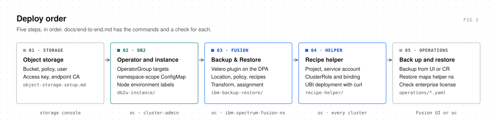
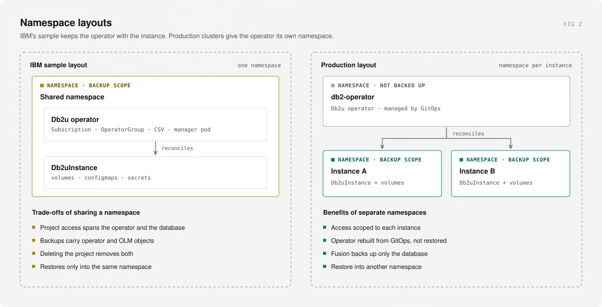
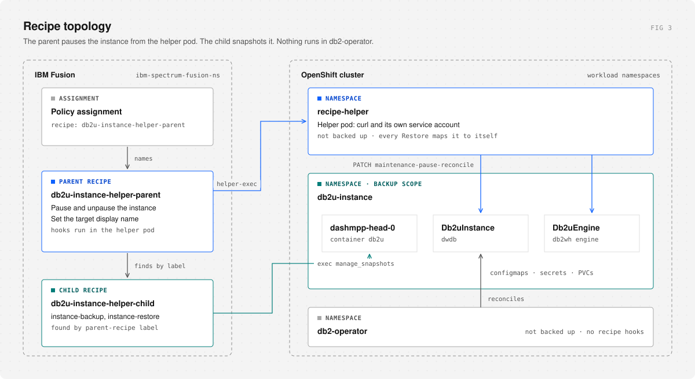
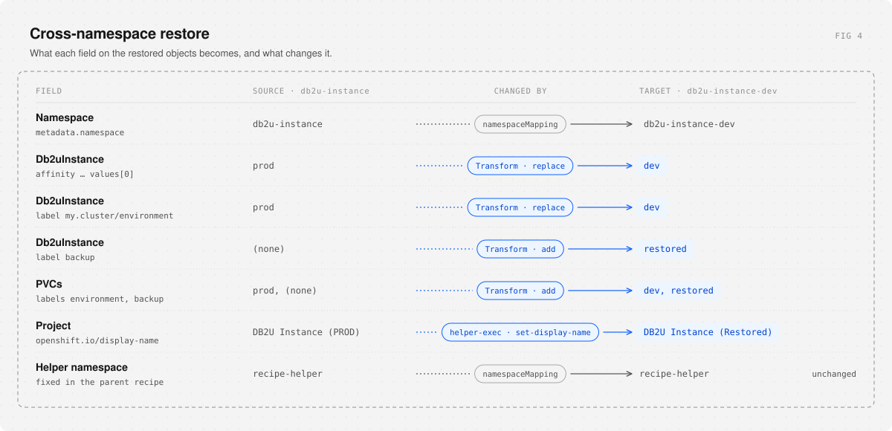
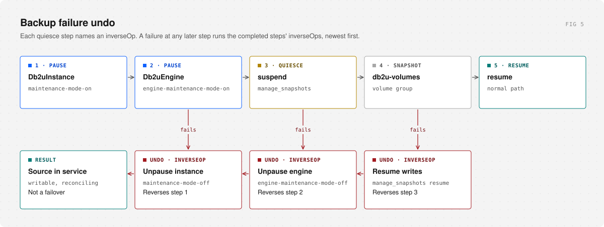

[](https://www.ibm.com/docs/en/fusion-software/2.12.0?topic=recipe-dynamic)
[](docs/end-to-end.md)
[](https://github.com/nick-draper/fusion-bnr-db2/commits/main)

# Db2uInstance backup and restore for IBM Fusion

A production recipe for protecting a **Db2uInstance** with IBM Fusion Backup & Restore when the Db2u operator and the database are in different namespaces, and for restoring that backup into another namespace.

Everything needed to run it is here: the recipes, the transform, a small recipe helper, the Fusion and Db2 manifests for a worked example, step-by-step deployment commands with a check after each step, and a runbook with screenshots.

- Maintenance mode is set and cleared from a recipe helper pod, so no hook runs in the operator namespace
- Parent/child dynamic recipe with an allow-list of resource types
- `inverseOp` undo of every completed quiesce step if a later backup step fails
- Cross-namespace restore with a Transform, `namespaceMapping` and a target display name
- Deployment you run command by command, with a check after each step, before a backup, and after a restore

## Quick start

You need Fusion Backup & Restore **2.10 or newer** (tested on 2.12.2), a Db2u operator in its own namespace, a `Db2uInstance` on Db2 **12.1.4 or newer**, S3-compatible object storage, and `oc` logged in as cluster-admin.

The worked example backs up **`db2u-instance`** and restores it into **`db2u-instance-dev`**.

<picture>
  <source media="(prefers-color-scheme: dark)" srcset="docs/images/deploy-dark.svg">
  
</picture>

| Step | Guide | Files |
| --- | --- | --- |
| 1. Object storage: bucket, policy, user, access key | [object-storage-setup.md](docs/object-storage-setup.md) | none (done on the storage side) |
| 2. Db2 operator scope, projects, instance | [end-to-end §2](docs/end-to-end.md#2-db2-operator-projects-and-instance) | [`db2u-instance/`](db2u-instance/) |
| 3. Fusion: Velero plugin, storage location, policy, recipes, transform, assignment | [end-to-end §3](docs/end-to-end.md#3-ibm-fusion-backup--restore) | [`ibm-backup-restore/`](ibm-backup-restore/) |
| 4. Recipe helper | [end-to-end §4](docs/end-to-end.md#4-recipe-helper) | [`recipe-helper/`](recipe-helper/) |
| 5. Back up and restore | [operations.md](docs/operations.md) | [`ibm-backup-restore/operations/`](ibm-backup-restore/operations/) |

Put your values in `.env` and render the manifests:

```bash
cp .env.example .env        # then fill it in
./scripts/render.sh         # writes filled manifests to build/
```

There is no install script. `render.sh` only writes files; it never contacts the cluster. Then follow [docs/end-to-end.md](docs/end-to-end.md) from the top: it applies the files in `build/` with `oc`, one step at a time, with a check before you move on.

Before the first backup, every line of [Ready to back up?](docs/end-to-end.md#ready-to-back-up) must pass. Backups, restores and their checks are in [operations.md](docs/operations.md).

## Layout

```text
README.md                         why, how it runs, quick start
.githooks/                        pre-commit hook that blocks a filled license or key
docs/                             runbook, object storage, operations, diagrams, screenshots
.env.example                      your values: namespaces, license, storage class, object storage
db2u-instance/                    projects, Db2uInstance, operator scope         (template)
ibm-backup-restore/
├── backend-storage-location/     credentials secret, storage location, policy  (template)
├── recipe/                       parent and child recipes                       (apply as is)
├── transform/                    restore transform                              (check JSON paths)
├── policy-assignment/            application + policy + parent recipe           (apply as is)
├── operations/                   Backup and Restore CRs                         (template; name per run)
└── config/                       Velero plugin note, not a manifest
recipe-helper/                    project, service account, RBAC, deployment     (set image)
scripts/                          render (.env to build/), placeholder check (pre-commit), discovery
build/                            rendered manifests you apply (git-ignored)
```

### What you edit

Your values live in `.env`; the YAML files are templates with `${NAME}` placeholders, and [`scripts/render.sh`](scripts/render.sh) writes filled copies to `build/`.

| `.env` key | Fills | Example |
| --- | --- | --- |
| `FUSION_NS` | Namespace of the storage location, policy, recipes, transform, assignment, backups and restores | `ibm-spectrum-fusion-ns` |
| `OP_NS` | Db2u operator namespace: OperatorGroup and `namespace-scope` ConfigMap | `db2-operator` |
| `SOURCE_NS` | Instance namespace and Fusion Application; `namespaceMapping` source | `db2u-instance` |
| `TARGET_NS` | Restore target project; `namespaceMapping` target | `db2u-instance-dev` |
| `HELPER_NS` | Recipe helper namespace, the parent recipe's hook namespace, and its `namespaceMapping` entry | `recipe-helper` |
| `DB2_LICENSE` | License in `db2u-instance.yaml` | |
| `STORAGE_CLASS` | `storageClassName` of all three instance volumes | `isf-block-file-delete-sc` |
| `S3_BUCKET_NAME`, `S3_ENDPOINT`, `S3_REGION` | Backup storage location | `db2u-instance-bucket` |
| `S3_ACCESS_KEY_ID`, `S3_ACCESS_KEY` | Access key pair in `secret.yaml`; `S3_ACCESS_KEY` is the secret key | |

Two values are not in `.env`:

| File | Set |
| --- | --- |
| [`recipe-helper/deployment.yaml`](recipe-helper/deployment.yaml) | `image` (your mirrored UBI 9 minimal), in the template |
| `build/ibm-backup-restore/operations/backup.yaml`, `restore.yaml` | `metadata.name` per run; `spec.backup` and `transformMapping.ENV` on the Restore, in the rendered copy |

`${GROUP...}` in the recipes and `${ENV}` in the Transform are Fusion's own variables. `render.sh` leaves them alone.

`.env` and `build/` are git-ignored. A pre-commit hook also blocks a commit that stages them or that fills a template's license or key in place, once you enable it in your clone:

```bash
git config core.hooksPath .githooks
```

It runs [`scripts/check-placeholders.sh`](scripts/check-placeholders.sh).

The instance name, `dwdb`, is not a variable. If yours differs, change `metadata.name` in `db2u-instance.yaml` and `resourceNameRegex` in the Transform, and set `INSTANCE` in your shell (end-to-end §0). Use your environment label in place of `dev`.

## Why this recipe exists

IBM's sample [`db2u-instance-backup-restore-recipe.yaml`](https://github.com/IBM/storage-fusion/blob/master/backup-restore/recipes/Db2/db2u-instance-backup-restore-recipe.yaml) shows the mechanics correctly for a lab where the operator and the instance share a project, and restores only into the same namespace. Most OpenShift clusters use a different layout: one operator project, one namespace per instance. This recipe is for that layout.

### The layout the sample does not cover

The operator lives in a namespace such as `db2-operator`, deployed and upgraded by GitOps. Each database is a `Db2uInstance` in its own project. That split is how you keep RBAC, tenancy, and upgrades apart, and it changes what a backup should contain: the operator comes back from GitOps, so Fusion only needs the instance.

<picture>
  <source media="(prefers-color-scheme: dark)" srcset="docs/images/layouts-dark.svg">
  
</picture>

The sample looks for `control-plane=db2u-operator-manager` in the **instance** namespace:

```yaml
namespace: ${GROUP.db2u-volumes.namespace}
```

The manager pod is not there, so these hooks never run:

- `db2u-operator-manager-exec/maintenance-mode-on`
- `db2u-operator-manager-exec/engine-maintenance-mode-on`

Fusion still creates the Backup. The database is never placed in maintenance mode, and the snapshot is not taken. The failure shows in the hook log, not in whether the Backup exists.

The sample also limits restore to the **same** namespace. Promoting prod to dev or QA, rebuilding a project, or recovering onto a spoke all need a different target, rewritten affinity and labels, and a Project display name that belongs to the target.

### What changed from the sample

| Gap in the sample | What this recipe does |
| --- | --- |
| Operator hooks run in the instance namespace | Exec hooks in the `recipe-helper` pod patch the `Db2uInstance` and `Db2uEngine` through the API. No hook runs in `db2-operator` |
| Operator, subscriptions, and the database are one backup | The Application is the instance namespace only (Fusion discovers it as `db2u-instance`) |
| Exclude-list, then copy everything else | Allow-list: volumes, configmaps, secrets, `Db2uInstance` |
| No undo if a backup step fails after quiesce starts | `inverseOp` on suspend and both maintenance-on steps; a later failure undoes each completed step, newest first |
| Same-namespace restore only | Transform, `namespaceMapping`, and a Restore example |
| Target Project keeps the source display name | `helper-exec/set-display-name` sets `DB2U Instance (Restored)` on the target namespace |
| One flat recipe | Fusion parent/child dynamic recipe. The assignment names the parent |
| Nothing marks a restored database | The Transform adds label `backup=restored` to the restored `Db2uInstance` and its PVCs |

## How it works

The parent recipe owns maintenance mode and restore ordering. The child owns the instance. The PolicyAssignment names only the parent; Fusion finds the child from its labels:

```yaml
dp.isf.ibm.com/parent-recipe: db2u-instance-helper-parent
dp.isf.ibm.com/parent-recipe-namespace: ibm-spectrum-fusion-ns
```

Maintenance mode is an annotation (`db2u.databases.ibm.com/maintenance-pause-reconcile`) on the `Db2uInstance` and `Db2uEngine`. The parent sets and clears it from a small **recipe helper** pod in its own namespace, `recipe-helper`. The helper calls the Kubernetes API with its own service account. The operator reacts to the annotation wherever it runs, and no hook runs in `db2-operator`.

<picture>
  <source media="(prefers-color-scheme: dark)" srcset="docs/images/architecture-dark.svg">
  
</picture>

Every instance hook uses `${GROUP.db2u-db2uinstances.namespace}`, from a resource-type anchor group in the parent, so it follows `namespaceMapping` on restore.

```text
backup:  pause instance → pause engine → instance-backup → unpause engine → unpause instance
restore: set target display name → instance-restore → wait 300 s
         → unpause engine → unpause instance

instance-backup:  resources → Db2uInstance → suspend → volumes → resume
instance-restore: volumes → resources → Db2uInstance → engine Ready
                  → snapshot restore → resume → instance Ready
```

The `Db2uInstance` is backed up while paused, so it comes back paused. The parent clears maintenance at the end of the restore, after the child's readiness checks and a 300 s settle.

Groups use `includedResourceTypes`. The sample uses an exclude list and backs up whatever remains, which pulls operator and OLM objects into the backup when they share the namespace. An allow-list leaves a new type out until you add it. Run [`scripts/discover-instance-resources.sh`](scripts/discover-instance-resources.sh) against a real instance namespace before you widen the list.

`manage_snapshots` runs in container `db2u` on pod `dashmpp-head-0`. That stays an exec hook, in the JSON-array form (`["/bin/bash", "-c", "manage_snapshots --action suspend --retry 3"]`); the multi-line shell form did not run there. A Job hook starts another pod, with another image and identity, and cannot see the binary.

Fusion reads any dollar-brace text in a recipe as a variable, including in comments. Keep it out of comments, and use `$name` without braces for shell variables in commands.

The `Db2uInstance` must carry `for-backup=true`: the readiness check selects on it. The example manifest sets it. For an instance created without it, run `oc label db2uinstances.db2u.databases.ibm.com --all -n <namespace> for-backup=true --overwrite` ([end-to-end §2.4](docs/end-to-end.md#24-db2uinstance)).

Assign `db2u-instance-helper-parent` on the PolicyAssignment **before the first backup**. A backup taken with no recipe has no quiesce and no resource order, and a later restore cannot add them. See [I didn't use a recipe on backup](https://community.ibm.com/community/user/blogs/jim-smith/2024/03/13/fusion-recipe-tips-no-backup-recipe).

### Why a helper pod

Earlier versions ran the maintenance patches as `curl` exec hooks inside the operator manager pod, in `db2-operator`. Backup worked. A cross-namespace restore failed while Fusion was still building the restore recipe:

```text
recipeloader.py ... in _create_from_spec
KeyError: 'db2-operator'
Required parameters missing for restore 'db2-operator'
```

The parent/child restore loader looks up each **fixed** hook namespace in the Restore's `namespaceMapping`. Fusion annotation hooks in the instance namespace avoided the fixed namespace, but during restore the `GROUP` variable did not resolve in the dynamic recipe, so they could not be used.

The helper is the compromise. It is a minimal UBI pod with `curl`, its own service account, and a ClusterRole limited to Db2u instances and engines (get, list, watch, patch) and namespaces (get, list, patch). It has no pod or exec access. The hooks no longer depend on the operator pod's image or token. Its namespace is still fixed, so **every Restore maps it to itself**:

```yaml
namespaceMapping:
  recipe-helper: recipe-helper
  db2u-instance: db2u-instance-dev
```

Leave that line out and the restore fails with `KeyError: 'recipe-helper'`. [`ibm-backup-restore/operations/restore.yaml`](ibm-backup-restore/operations/restore.yaml) carries it.

[End-to-end §4](docs/end-to-end.md#4-recipe-helper) deploys the helper and its ClusterRole and checks the permissions with `oc auth can-i`. Do it on every cluster that backs up **and** every cluster that restores. Without it the helper hooks fail with Forbidden.

## Restoring into another namespace

A backup taken in namespace A does not apply unchanged in namespace C. Affinity still says prod. Labels still name the source environment. The OpenShift Project keeps the source `openshift.io/display-name`. Restores failed more often on these than in the backup hooks, including instances that came back and then sat in maintenance shutdown because those references still held the source values.

Four things have to move together:

1. `namespaceMapping` on the Restore: the instance (`db2u-instance` to `db2u-instance-dev`) and the helper namespace to itself.
2. A Transform whose JSON paths match your `Db2uInstance`. [`ibm-backup-restore/transform/transform.yaml`](ibm-backup-restore/transform/transform.yaml) rewrites the `Db2uInstance` affinity value and `my.cluster/environment` label to `${ENV}` (set by `transformMapping` on the Restore), and sets the same label on every restored PVC. Both get `backup=restored`. It is a starting point, not a schema for every cluster.
3. The Db2u operator must watch the target. Add it to the OperatorGroup and `namespace-scope` ConfigMap in `db2-operator` before you restore, or nothing reconciles the restored instance.
4. Worker nodes labelled for the target environment (`my.cluster/environment=dev`), or the rewritten affinity cannot schedule.

`set-display-name` writes `DB2U Instance (Restored)` over whatever display name the target Project manifest set. Create the target project before you apply the Restore.

<picture>
  <source media="(prefers-color-scheme: dark)" srcset="docs/images/transform-dark.svg">
  
</picture>

### Credentials and license

Files on disk are not a working instance. Before Db2 12.1.4, OADP restored the database and left credentials and license configuration behind. The pod could start, the restore could look successful, and the instance still could not operate. The usual sign was a trial license, because `db2-lic` had not been preserved.

Db2 **12.1.4** added `db2u-velero-plugin` for that. Install it on the Fusion DataProtectionApplication with IBM's current image, not a digest copied into git: [Fusion backup and restore utility](https://www.ibm.com/docs/en/software-hub/5.4.x?topic=utilities-fusion-backup-restore-utility). Confirm the enterprise license after every cross-namespace test. A Ready pod on a trial license is a failed restore.

On releases older than 12.1.4, the workaround was to put the enterprise license in `db2-lic` before backup so the restored files already contained it. Move to 12.1.4 and the plugin when you can.

## If a backup step fails

Quiesce is what makes the copy consistent, and it is also how a failed backup takes the database out of service. Suspend and both maintenance-on steps name an `inverseOp`. If any later step fails, Fusion runs the `inverseOp` of every step already completed, newest first. A failed volume snapshot resumes I/O, then clears engine maintenance, then clears instance maintenance. A failed suspend clears engine and then instance maintenance. A failed engine pause clears instance maintenance.

<picture>
  <source media="(prefers-color-scheme: dark)" srcset="docs/images/failover-dark.svg">
  
</picture>

That path puts the **source** database back into service. It is not a failover to another site. Recovery into another namespace is the Restore in the previous section. The pattern is IBM's [undo an operation](https://community.ibm.com/community/user/blogs/sandeep-prajapati/2024/04/05/fusion-recipe-tips-how-to-undo-an-operation-in-cas) note.

## Slow restores and timeouts

Db2 recovery can take a long time. Crash recovery, log replay, and rollback are heavy on CPU, memory, and disk. An undersized pod, a slow storage class, or an eviction can stretch a restore for hours. Fusion may report the recipe step complete while the database is still recovering, or the Restore may hit its timeout.

Size the target for recovery, not for steady state. Watch pod CPU, memory, and volume latency while `manage_snapshots restore` and the readiness checks run. Set the Restore timeout from a measured run in your cluster. Cancel a stuck restore before the timeout fires.

We also saw a Restore timeout followed by deletion of the **target** namespace, rather than a partial apply left in place. Treat that as a data-loss risk:

- Measure restore time before you depend on it.
- Set the timeout above that measurement.
- If a target namespace disappears, read the Restore status and the audit log before you assume a person deleted the project.

## Out of scope

- `Db2uCluster`
- Backing up the operator, OLM subscriptions, or cluster-scoped objects
- Job hooks, and parallel children. Parallel execution only helps when one Application covers several instances and every parallel sequence is hooks only. A volume group forces sequential execution.
- Real object-storage keys and the Db2 license. The manifests leave those as `<...>` placeholders

## Further reading

- [IBM Fusion Db2 recipes](https://github.com/IBM/storage-fusion/tree/master/backup-restore/recipes/Db2)
- [Dynamic parent/child recipes](https://community.ibm.com/community/user/blogs/ashish-gupta/2025/06/04/fusion-dynamic-recipe)
- [Undo with `inverseOp`](https://community.ibm.com/community/user/blogs/sandeep-prajapati/2024/04/05/fusion-recipe-tips-how-to-undo-an-operation-in-cas)
- [Make a recipe generic](https://community.ibm.com/community/user/blogs/ashish-gupta/2024/03/25/fusion-recipe-tips-keeping-database-credentials-a)
- [Check hook conditions](https://community.ibm.com/community/user/blogs/sandeep-prajapati/2025/06/12/how-to-write-fusion-recipe-check-hook-condition-st)
- [Label and annotation hooks](https://community.ibm.com/community/user/blogs/sandeep-prajapati/2025/06/12/using-fusion-label-and-annotation-hooks)
- [Resource discovery](https://community.ibm.com/community/user/blogs/sandeep-prajapati/2026/01/11/making-kubernetes-or-openshift-backup-and-restore)

## Disclaimer

Provided as is, without warranty, in line with the [IBM/storage-fusion recipes disclaimer](https://github.com/IBM/storage-fusion/tree/master/backup-restore/recipes#disclaimer). Review and test everything in your own environment before you use it in production.
