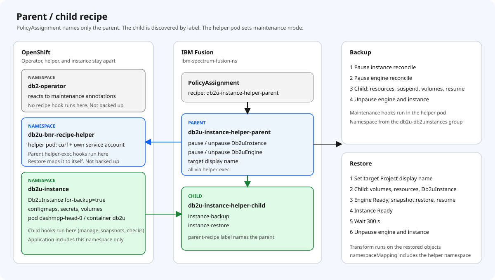
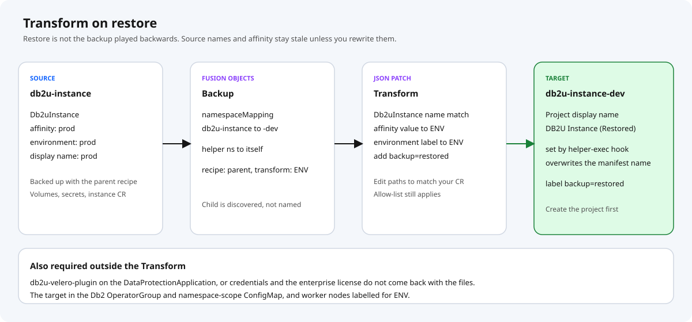
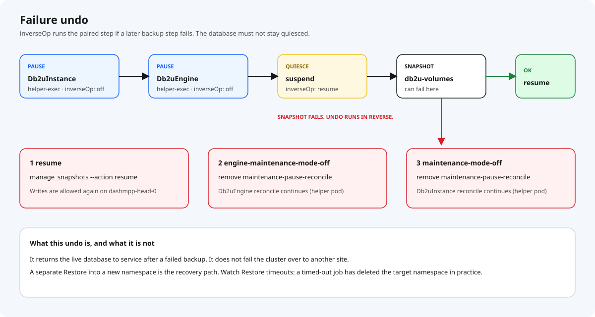
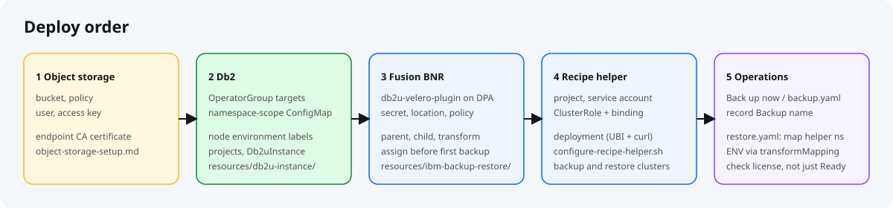

[](https://www.ibm.com/docs/en/fusion-software/2.12.0?topic=recipe-dynamic)
[](https://github.com/IBM/storage-fusion/tree/master/backup-restore/recipes/Db2)
[](docs/end-to-end.md)

# Db2uInstance backup and restore with a recipe helper

Recipes for protecting a **Db2uInstance** when the Db2u operator and the database are in different namespaces, and for restoring that backup into another namespace.

IBM’s [`db2u-instance-backup-restore-recipe.yaml`](https://github.com/IBM/storage-fusion/blob/master/backup-restore/recipes/Db2/db2u-instance-backup-restore-recipe.yaml) shows the mechanics correctly for a lab where the operator and the instance share a project. This repository is what we run instead on the layout OpenShift clusters actually use: one operator project, one namespace per instance.

Step-by-step deploy, backup, and restore is in [docs/end-to-end.md](docs/end-to-end.md).

## Where this fits in IBM/storage-fusion

This folder is laid out to sit at `backup-restore/recipes/Db2/db2u-instance-helper/` in [IBM/storage-fusion](https://github.com/IBM/storage-fusion/tree/master/backup-restore/recipes/Db2), next to the existing `db2u-instance-backup-restore-recipe.yaml` and `other-recipes/`. It is a variant of that recipe, not a replacement.

| Upstream (`recipes/Db2/`) | This variant |
| --- | --- |
| `db2u-instance-backup-restore-recipe.yaml` | `db2u-instance-helper-parent-recipe.yaml` + `db2u-instance-helper-child-recipe.yaml` |
| (none) | `db2u-instance-restore-transform.yaml` |
| `backup-pre-req.sh` | `scripts/backup-pre-req.sh` |
| `restore-pre-req.sh` (ClusterRoles for restore) | `scripts/configure-recipe-helper.sh` with `db2u-bnr-recipe-helper/`, on every backup and restore cluster |
| README steps | `docs/`, `scripts/configure-bnr.sh`, `scripts/test-bnr.sh` |

The recipe files, the helper and `scripts/` are the contribution. `examples/` is the environment the worked example ran on (projects, `Db2uInstance`, storage location, policy, assignment, Backup and Restore CRs) and is there to make the example reproducible.

## Who this is for

Platform and database engineers who followed the official recipe, got a Backup object, and then found the backup had not run. Or who restored into a new project and got an instance that still looked like production.

## The layout the sample does not cover

The operator lives in a namespace such as `db2-operator`. Each database is a `Db2uInstance` in its own project. That split is how you keep RBAC, tenancy, and upgrades apart. It is the normal pattern.

The sample searches for `control-plane=db2u-operator-manager` in the **instance** namespace:

```yaml
namespace: ${GROUP.db2u-volumes.namespace}
```

The manager pod is not there, so these hooks never run:

- `db2u-operator-manager-exec/maintenance-mode-on`
- `db2u-operator-manager-exec/engine-maintenance-mode-on`

Fusion still creates the Backup. The database is never placed in maintenance mode, and the snapshot is not taken. The failure is in the hook log, not in the Backup’s existence.

The same README also limits restore to the **same** namespace. Promoting prod to dev or QA, rebuilding a project, or recovering onto a spoke all need a different target, rewritten affinity and labels, and a Project display name that belongs to that target.

The parent recipe owns maintenance mode and restore ordering. The child owns the instance. A PolicyAssignment names only the parent. Fusion finds the child from its labels.

Maintenance mode is an annotation (`db2u.databases.ibm.com/maintenance-pause-reconcile`) on the `Db2uInstance` and `Db2uEngine`. The parent sets and clears it from a small **recipe helper** pod in its own namespace, `db2u-bnr-recipe-helper`. The helper calls the Kubernetes API with its own service account. The operator reacts to the annotation wherever it runs, and no hook runs in `db2-operator`.



## What changed from the sample

| Gap in the sample | What this repository does |
| --- | --- |
| Operator hooks run in the instance namespace | Exec hooks in the `db2u-bnr-recipe-helper` pod patch the `Db2uInstance` and `Db2uEngine` through the API. No hook runs in `db2-operator` |
| Operator, subscriptions, and the database are one backup | The Application is the instance namespace only (Fusion discovers it as `db2u-instance`) |
| Exclude-list, then copy everything else | Allow-list: volumes, configmaps, secrets, `Db2uInstance` |
| No undo if the snapshot fails after suspend | `inverseOp` resumes I/O and clears maintenance |
| Same-namespace restore only | Transform, `namespaceMapping`, and a Restore example |
| Target Project keeps the source display name | `helper-exec/set-display-name` sets `DB2U Instance (Restored)` on the target namespace |
| One flat recipe | Fusion parent/child dynamic recipe. The assignment names the parent |
| Nothing marks a restored database | The Transform adds label `backup=restored` to the restored `Db2uInstance` |

[`scripts/configure-recipe-helper.sh`](scripts/configure-recipe-helper.sh) deploys the helper and its ClusterRole and checks the permissions. Run it on every cluster that backs up **and** every cluster that restores. Without it the helper hooks fail with Forbidden. The `Db2uInstance` must carry `for-backup=true`: the readiness check selects on it. The sample manifest sets it; [`scripts/backup-pre-req.sh`](scripts/backup-pre-req.sh) adds it to instances created without it.

## How backup and restore run

Fusion builds one workflow from a parent plus a child. Every instance hook uses `${GROUP.db2u-db2uinstances.namespace}`, from a resource-type anchor group in the parent, which follows `namespaceMapping` on restore.

```text
backup:  pause instance → pause engine → instance-backup → unpause engine → unpause instance
restore: set target display name → instance-restore → wait 300 s
         → unpause engine → unpause instance

instance-backup:  resources → Db2uInstance → suspend → volumes → resume
instance-restore: volumes → resources → Db2uInstance → engine Ready
                  → snapshot restore → resume → instance Ready
```

The `Db2uInstance` is backed up while paused, so it comes back paused. The parent clears maintenance at the end of the restore, after the child’s readiness checks and a 300 s settle.

The child carries:

```yaml
dp.isf.ibm.com/parent-recipe: db2u-instance-helper-parent
dp.isf.ibm.com/parent-recipe-namespace: ibm-spectrum-fusion-ns
```

Groups use `includedResourceTypes`. The sample uses an exclude list and then backs up whatever remains, which pulls operator and OLM objects into the backup when they share the namespace. An allow-list leaves a new type out until you add it. Run [`scripts/discover-instance-resources.sh`](scripts/discover-instance-resources.sh) against a real instance namespace before you widen the list.

`manage_snapshots` runs in container `db2u` on pod `dashmpp-head-0`. That stays an exec hook, in the JSON-array form (`["/bin/bash", "-c", "manage_snapshots --action suspend --retry 3"]`); the multi-line shell form did not run there. A Job hook starts another pod, with another image and identity, and cannot see the binary.

Fusion reads any dollar-brace text in a recipe as a variable, including in comments. Keep it out of comments, and use `$name` without braces for shell variables in commands.

### Why a helper pod

Earlier versions ran the maintenance patches as `curl` exec hooks inside the operator manager pod, in `db2-operator`. Backup worked. A cross-namespace restore failed while Fusion was still building the restore recipe:

```text
recipeloader.py ... in _create_from_spec
KeyError: 'db2-operator'
Required parameters missing for restore 'db2-operator'
```

The parent/child restore loader looks up each **fixed** hook namespace in the Restore’s `namespaceMapping`. Fusion annotation hooks in the instance namespace avoided the fixed namespace, but during restore the `GROUP` variable did not resolve in the dynamic recipe, so they could not be used.

The helper is the compromise. It is a minimal UBI pod with `curl`, its own service account, and a ClusterRole limited to the Db2u objects and namespaces. The hooks no longer depend on the operator pod’s image or token. Its namespace is still fixed, so **every Restore maps it to itself**:

```yaml
namespaceMapping:
  db2u-bnr-recipe-helper: db2u-bnr-recipe-helper
  db2u-instance: db2u-instance-dev
```

Leave that line out and the restore fails with `KeyError: 'db2u-bnr-recipe-helper'`. [`examples/operations/restore.yaml`](examples/operations/restore.yaml) carries it.

Assign `db2u-instance-helper-parent` on the PolicyAssignment **before the first backup**. A backup taken with no recipe has no quiesce and no resource order, and a later restore cannot invent them. See [I didn’t use a recipe on backup](https://community.ibm.com/community/user/blogs/jim-smith/2024/03/13/fusion-recipe-tips-no-backup-recipe).

## Restoring into another namespace

A backup taken in namespace A does not apply unchanged in namespace C. Affinity still says prod. Labels still name the source environment. The OpenShift Project keeps the source `openshift.io/display-name`. The sample ships no Transform. Restores failed here more often than they failed in the backup hooks, including instances that returned and then sat in maintenance shutdown because those references were still the source values.

Four things have to move together:

1. `namespaceMapping` on the Restore: the instance (`db2u-instance` to `db2u-instance-dev`) and the helper namespace to itself.
2. A Transform whose JSON paths match your `Db2uInstance`. [`db2u-instance-restore-transform.yaml`](db2u-instance-restore-transform.yaml) rewrites the affinity value and the `my.cluster/environment` label to `${ENV}` (set by `transformMapping` on the Restore) and adds `backup=restored`. It is a starting point, not a schema for every cluster.
3. The Db2u operator must watch the target. Add it to the OperatorGroup and `namespace-scope` ConfigMap in `db2-operator` before you restore, or nothing reconciles the restored instance.
4. Worker nodes labelled for the target environment (`my.cluster/environment=dev`), or the rewritten affinity cannot schedule.

`set-display-name` writes `DB2U Instance (Restored)` over whatever display name the target Project manifest set.

Create the target project before you apply the Restore.



Files on disk are not a working instance. Before Db2 12.1.4, OADP restored the database and left credentials and license configuration behind. The pod could start, the restore could look successful, and the instance still could not operate. The usual sign was a trial license, because `db2-lic` had not been preserved.

Db2 **12.1.4** added `db2u-velero-plugin` for that. Reporting the gap is part of why the plugin exists. Install it on the Fusion DataProtectionApplication with IBM’s current image, not a digest copied into git: [Fusion backup and restore utility](https://www.ibm.com/docs/en/software-hub/5.4.x?topic=utilities-fusion-backup-restore-utility). Confirm the enterprise license after every cross-namespace test. A Ready pod on a trial license is a failed restore.

On releases older than 12.1.4, the bridge was to put the enterprise license in `db2-lic` before backup so the restored files already contained it. Move to 12.1.4 and the plugin when you can.

## If the snapshot fails

Quiesce is what makes the copy consistent, and it is also how a failed backup takes the database out of service. Suspend and both maintenance-on steps name an `inverseOp`. If the volume snapshot fails, Fusion runs those undos in reverse: resume I/O, then clear engine maintenance, then clear instance maintenance.



That path puts the **source** database back into service. It is not a failover to another site. Recovery into another namespace is the Restore in the previous section. The pattern is IBM’s [undo an operation](https://community.ibm.com/community/user/blogs/sandeep-prajapati/2024/04/05/fusion-recipe-tips-how-to-undo-an-operation-in-cas) note.

## Slow restores and timeouts

The sample does not say how long Db2 recovery takes. Crash recovery, log replay, and rollback are heavy on CPU, memory, and disk. An undersized pod, a slow storage class, or an eviction can stretch a restore for hours. Fusion may report the recipe step complete while the database is still recovering, or the Restore may hit its timeout.

Size the target for recovery, not for steady state. Watch pod CPU, memory, and volume latency while `manage_snapshots restore` and the readiness checks run. Set the Restore timeout from a measured run in your cluster. Cancel a stuck restore before the timeout fires.

While implementing this we also saw a Restore timeout followed by deletion of the **target** namespace, rather than a partial apply left in place. Treat that as a data-loss risk:

- Measure restore time before you depend on it.
- Set the timeout above that measurement.
- If a target namespace disappears, read the Restore status and the audit log before you assume a person deleted the project.

## Put it on a cluster

Worked example namespaces: **`db2u-instance`** (source) → **`db2u-instance-dev`** (restore target).

You need Fusion Backup & Restore **2.10 or newer** (tested on 2.12.2), a Db2u operator in its own namespace, a `Db2uInstance` on Db2 **12.1.4 or newer**, the Velero plugin on the Fusion DataProtectionApplication, S3-compatible object storage, and `oc` on the workstation.



| Step | Guide | Files |
| --- | --- | --- |
| 1. Object storage: bucket, policy, user, access key | [docs/object-storage-setup.md](docs/object-storage-setup.md) | none (done on the storage side) |
| 2. Db2 operator scope, projects, instance | [end-to-end §2](docs/end-to-end.md#2-db2-operator-projects-and-instance) | [`examples/db2u-instance/`](examples/db2u-instance/) |
| 3. Fusion BNR: Velero plugin, storage location, policy, recipes, transform, assignment | [end-to-end §3](docs/end-to-end.md#3-ibm-fusion-backup--restore) | [`examples/ibm-backup-restore/`](examples/ibm-backup-restore/), recipes and transform in this folder |
| 4. Recipe helper | [end-to-end §4](docs/end-to-end.md#4-recipe-helper) | [`db2u-bnr-recipe-helper/`](db2u-bnr-recipe-helper/) |
| 5. Operations: backup and restore | [docs/operations.md](docs/operations.md) | [`examples/operations/`](examples/operations/) |

Fill the `<...>` placeholders, then:

```bash
./scripts/configure-bnr.sh          # steps 2-4
./scripts/test-bnr.sh before
# back up: Fusion UI or examples/operations/backup.yaml
./scripts/test-bnr.sh after-backup
# set spec.backup in examples/operations/restore.yaml, apply it
./scripts/test-bnr.sh after-restore
```

Run the commands from this folder. File index: [end-to-end § File map](docs/end-to-end.md#file-map).

## Out of scope

- `Db2uCluster`
- Backing up the operator, OLM subscriptions, or cluster-scoped objects
- Job hooks, and parallel children. Parallel execution only helps when one Application covers several instances and every parallel sequence is hooks only. A volume group forces sequential execution.
- Real object-storage keys and the Db2 license. The manifests leave those as `<...>` placeholders

## Further reading

- [IBM Fusion Db2 recipes](https://github.com/IBM/storage-fusion/tree/master/backup-restore/recipes/Db2)
- [Dynamic parent/child recipes](https://community.ibm.com/community/user/blogs/ashish-gupta/2025/06/04/fusion-dynamic-recipe)
- [Undo with `inverseOp`](https://community.ibm.com/community/user/blogs/sandeep-prajapati/2024/04/05/fusion-recipe-tips-how-to-undo-an-operation-in-cas)
- [Make a recipe generic](https://community.ibm.com/community/user/blogs/ashish-gupta/2024/03/25/fusion-recipe-tips-keeping-database-credentials-a)
- [Check hook conditions](https://community.ibm.com/community/user/blogs/sandeep-prajapati/2025/06/12/how-to-write-fusion-recipe-check-hook-condition-st)
- [Label and annotation hooks](https://community.ibm.com/community/user/blogs/sandeep-prajapati/2025/06/12/using-fusion-label-and-annotation-hooks)
- [Resource discovery](https://community.ibm.com/community/user/blogs/sandeep-prajapati/2026/01/11/making-kubernetes-or-openshift-backup-and-restore)
