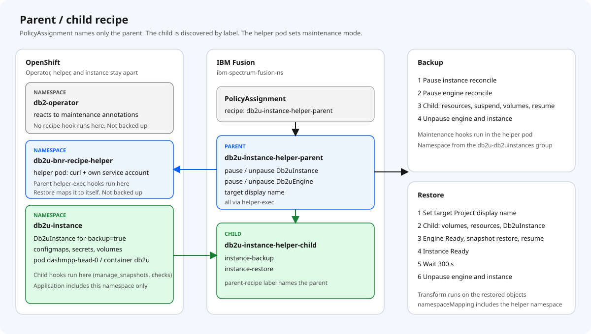
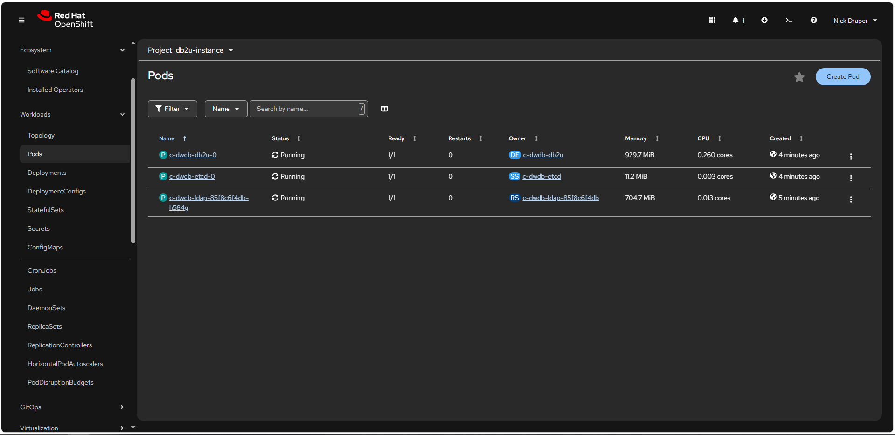
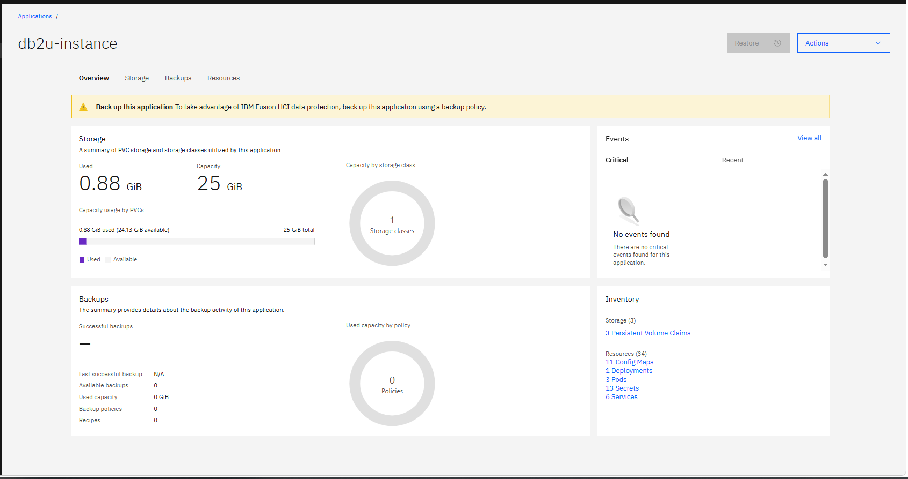
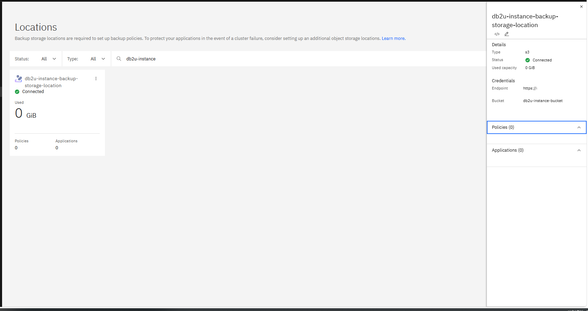
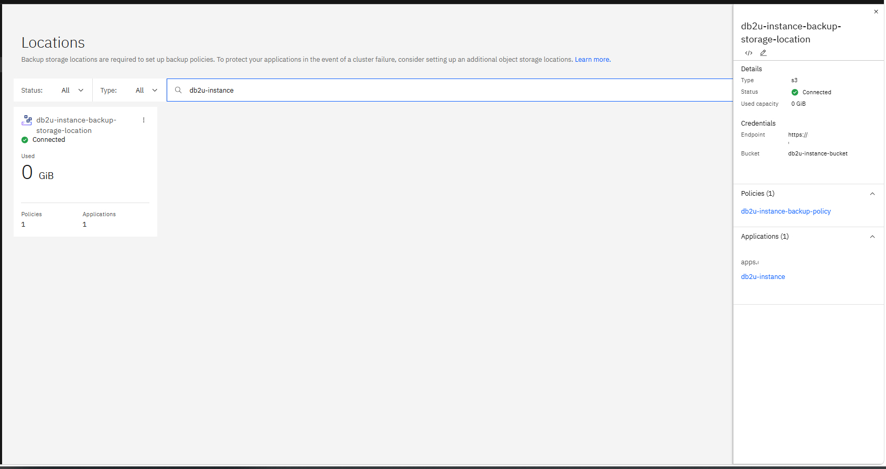
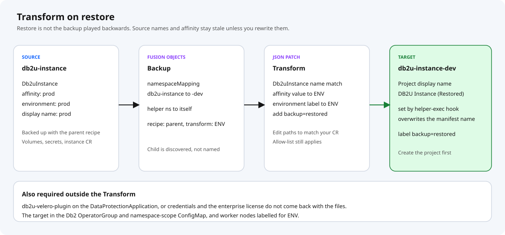
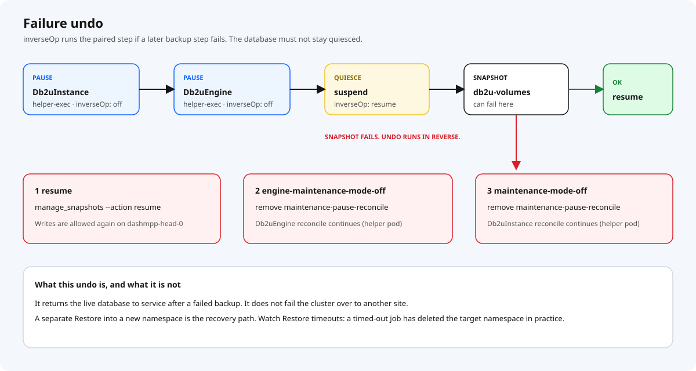

# Db2u Fusion Backup & Restore — end to end

Deploy and prove the recipes on the `db2u-instance` example, then restore it into `db2u-instance-dev`.

| Namespace | Role |
| --- | --- |
| `db2u-instance` | Source — live `Db2uInstance` `dwdb` (Fusion Application `db2u-instance`) |
| `db2u-instance-dev` | Target — empty project you restore into |
| `db2-operator` | Db2u operator only. Not backed up; no recipe hook runs here |
| `db2u-bnr-recipe-helper` | Recipe helper pod that pauses and unpauses the instance |
| `ibm-spectrum-fusion-ns` | Storage location, policy, recipes, transform, backups, restores |
| `ibm-backup-restore` | Fusion DataProtectionApplication (Velero plugin) |

```text
PolicyAssignment  db2u-instance-recipe-policy-assignment
  Application     db2u-instance (discovered by Fusion)
  BackupPolicy    db2u-instance-backup-policy → db2u-instance-backup-storage-location
  Recipe          db2u-instance-helper-parent
                    +-- discovers db2u-instance-helper-child (labels)
                    +-- helper-exec hooks run in db2u-bnr-recipe-helper
```



Prerequisites: Fusion Backup & Restore 2.10+ (tested on 2.12.2), the Db2u operator installed in `db2-operator`, Db2 12.1.4+, S3-compatible object storage, `oc` logged in as cluster-admin.

Run every command below from `backup-restore/recipes/Db2/db2u-instance-helper/`.

`./scripts/configure-bnr.sh` runs steps 2–4 once the manual parts are done. The steps below say what it applies and what it only checks.

---

## 1. Object storage

Create the bucket, policy, user, and access key: [object-storage-setup.md](object-storage-setup.md).

You leave this step with an endpoint URL, its CA certificate, a bucket name, and an access key pair.

---

## 2. Db2 operator, projects and instance

Files: [`examples/db2u-instance/`](../examples/db2u-instance/).

### 2.1 Let the operator watch the source and every restore target

The operator only reconciles namespaces in its OperatorGroup and the `namespace-scope` ConfigMap. A restore target missing from either comes back as an instance nothing reconciles.

[`config/db2-operator-group.yaml`](../examples/db2u-instance/config/db2-operator-group.yaml) shows the target state. **Edit the existing OperatorGroup**; do not apply a second one (OLM stops installing when a namespace has two). Its name is generated, so look it up:

```bash
oc get operatorgroup -n db2-operator
oc patch operatorgroup <name> -n db2-operator --type=json \
  -p '[{"op":"add","path":"/spec/targetNamespaces/-","value":"db2u-instance-dev"}]'
```

Then set the same list in [`config/namespace-scope-configmap.yaml`](../examples/db2u-instance/config/namespace-scope-configmap.yaml):

```bash
oc apply -f examples/db2u-instance/config/namespace-scope-configmap.yaml
```

Repeat both for every new restore target.

### 2.2 Label worker nodes

The instance requires nodes labelled `my.cluster/environment=<env>` (and not `scale.spectrum.ibm.com/role=afm`). The Transform rewrites that value on restore, so label nodes for each environment you restore into:

```bash
oc label node <node> my.cluster/environment=prod
oc label node <node> my.cluster/environment=dev
```

### 2.3 Projects

```bash
oc apply -f examples/db2u-instance/db2u-instance-project.yaml
oc apply -f examples/db2u-instance/db2u-instance-dev-project.yaml
```

Create the target project before any restore. Its display name is overwritten with `DB2U Instance (Restored)` when you restore into it.

### 2.4 Db2uInstance

In [`db2u-instance.yaml`](../examples/db2u-instance/db2u-instance.yaml) replace `<Insert License>` and `<storage-class>`. Do not commit the filled file. The manifest already carries `for-backup: 'true'`, which the recipe readiness check selects on.

```bash
oc apply -f examples/db2u-instance/db2u-instance.yaml
oc get db2uinstance dwdb -n db2u-instance -w     # wait for Ready
```



Fusion discovers the namespace as Application `db2u-instance`:



---

## 3. IBM Fusion Backup & Restore

Files: [`examples/ibm-backup-restore/`](../examples/ibm-backup-restore/).

### 3.1 Velero plugin

Install `db2u-velero-plugin` on the Fusion DataProtectionApplication with IBM's [Fusion backup and restore utility](https://www.ibm.com/docs/en/software-hub/5.4.x?topic=utilities-fusion-backup-restore-utility). Without it, credentials and the license do not come back with a restore. [`config/dpa-db2u-velero-plugin.note.yaml`](../examples/ibm-backup-restore/config/dpa-db2u-velero-plugin.note.yaml) is a note, not a manifest. Check:

```bash
oc get dpa velero -n ibm-backup-restore \
  -o jsonpath='{.spec.configuration.velero.customPlugins}' ; echo
```

### 3.2 Backup storage location

1. Create secret `minio-registry-cert-secret` in `ibm-spectrum-fusion-ns` holding the object storage endpoint's CA certificate, in the form your Fusion release documents for `privateCertificateName`. Skip it, and remove `privateCertificateName`, if the endpoint has a publicly trusted certificate.
2. Put the access key pair in [`secret.yaml`](../examples/ibm-backup-restore/backup-storage-location/secret.yaml) (`<access-key-id>`, `<secret-access-key>`). Do not commit the filled file.
3. Set `bucket` and `endpoint` in [`backup-storage-location.yaml`](../examples/ibm-backup-restore/backup-storage-location/backup-storage-location.yaml). `region` is required by the S3 client; MinIO ignores the value.

```bash
oc apply -f examples/ibm-backup-restore/backup-storage-location/secret.yaml
oc apply -f examples/ibm-backup-restore/backup-storage-location/backup-storage-location.yaml
```

The location should show **Connected**:



### 3.3 Backup policy

[`backup-policy.yaml`](../examples/ibm-backup-restore/backup-storage-location/backup-policy.yaml): daily at 04:00 Australia/Sydney, 5 days retention. `provider` must stay `isf-backup-restore`.

```bash
oc apply -f examples/ibm-backup-restore/backup-storage-location/backup-policy.yaml
```

### 3.4 Recipes and transform

```bash
oc apply -f db2u-instance-helper-parent-recipe.yaml
oc apply -f db2u-instance-helper-child-recipe.yaml
oc apply -f db2u-instance-restore-transform.yaml
```

The child is found by its `dp.isf.ibm.com/parent-recipe` labels; nothing names it directly. The Transform rewrites the affinity value and `my.cluster/environment` label to `${ENV}` from the Restore's `transformMapping`, and adds `backup=restored`. Edit its JSON paths to match your `Db2uInstance`.

### 3.5 Policy assignment

[`policy-assignment.yaml`](../examples/ibm-backup-restore/policy-assignment.yaml) ties Application `db2u-instance`, the policy, and the parent recipe together. Apply it **before the first backup**: a backup taken without the recipe has no quiesce, and a restore cannot add one later. `runNow: false` keeps it from starting a backup.

```bash
oc apply -f examples/ibm-backup-restore/policy-assignment.yaml
```



---

## 4. Recipe helper

Files: [`db2u-bnr-recipe-helper/`](../db2u-bnr-recipe-helper/).

The parent recipe's `helper-exec` hooks run `curl` in this pod with its service account token. They patch `maintenance-pause-reconcile` on every `Db2uInstance` and `Db2uEngine` in the instance namespace, and the target Project display name on restore. The ClusterRole grants that; without it the hooks fail with Forbidden.

1. Mirror a UBI 9 minimal image (it ships `curl`) and set `image` in [`deployment.yaml`](../db2u-bnr-recipe-helper/deployment.yaml).
2. Apply and verify, on every cluster that backs up **and** every cluster that restores:

```bash
./scripts/configure-recipe-helper.sh
```

That applies the project (Pod Security `restricted`), service account, ClusterRole, ClusterRoleBinding, and deployment, waits for the rollout, and checks the service account can list and patch the Db2u objects and patch namespaces.

The helper namespace is fixed in the recipe, so every Restore must map it to itself (`db2u-bnr-recipe-helper: db2u-bnr-recipe-helper`). See [README: Why a helper pod](../README.md#why-a-helper-pod).

Then:

```bash
./scripts/test-bnr.sh before
```

Do not start a backup until this passes.

---

## 5. Operations

Backups, restores, and the UI walkthrough: [operations.md](operations.md).

```bash
./scripts/test-bnr.sh after-backup
./scripts/test-bnr.sh after-restore     # RESTORE_ENV=dev by default
```



---

## Failures



| Symptom | Check |
| --- | --- |
| `KeyError: 'db2u-bnr-recipe-helper'` on restore | The Restore's `namespaceMapping` lacks `db2u-bnr-recipe-helper: db2u-bnr-recipe-helper` |
| `KeyError: 'db2-operator'` on restore | An old recipe still has a hook in `db2-operator`. Apply the current recipes |
| Helper hook `Forbidden` | `./scripts/configure-recipe-helper.sh` on that cluster; ClusterRoleBinding subject namespace |
| Helper hook finds no pod | Helper deployment not Running, or label `app=db2u-bnr-recipe-helper` changed |
| Restored instance never reconciles | Target missing from the OperatorGroup or `namespace-scope` ConfigMap (§2.1) |
| Restored pods Pending | No node labelled `my.cluster/environment=<ENV>` (§2.2) |
| Readiness check never matches | `for-backup=true` on the instance; engine labels in `db2uengine-check` |
| Variables / op command | Only `${GROUP.*}` in commands; shell vars use `$name`; no dollar-brace text in recipe comments |
| `manage_snapshots` op does not run | Use the JSON-array command form `["/bin/bash", "-c", "..."]` |
| Ready but license/trial | Velero plugin / Db2 12.1.4+ |

---

## File map

Paths are relative to `backup-restore/recipes/Db2/db2u-instance-helper/`. The recipe files sit at the top; `examples/` holds the environment for the worked example.

| Path | Role |
| --- | --- |
| `db2u-instance-helper-parent-recipe.yaml` | Parent recipe: maintenance mode, restore ordering, display name |
| `db2u-instance-helper-child-recipe.yaml` | Child recipe: the `Db2uInstance`, its volumes and snapshot hooks |
| `db2u-instance-restore-transform.yaml` | Transform for a cross-namespace restore |
| `db2u-bnr-recipe-helper/` | Helper project, service account, RBAC, deployment |
| `examples/db2u-instance/` | OperatorGroup and namespace-scope targets, projects, `Db2uInstance` |
| `examples/ibm-backup-restore/backup-storage-location/` | Credentials secret, storage location, backup policy |
| `examples/ibm-backup-restore/policy-assignment.yaml` | PolicyAssignment naming the parent recipe |
| `examples/ibm-backup-restore/config/` | Velero plugin note (not applied) |
| `examples/operations/backup.yaml` | Backup CR |
| `examples/operations/restore.yaml` | Restore CR: `db2u-instance` → `db2u-instance-dev` |
| `scripts/configure-bnr.sh` | Check placeholders and prerequisites, apply steps 2–4 |
| `scripts/configure-recipe-helper.sh` | Apply and verify the helper (backup and restore clusters) |
| `scripts/test-bnr.sh` | `before` / `after-backup` / `after-restore` |
| `scripts/backup-pre-req.sh` | `for-backup=true` on instances created without it |
| `scripts/discover-instance-resources.sh` | Inventory a namespace before widening the allow-list |
