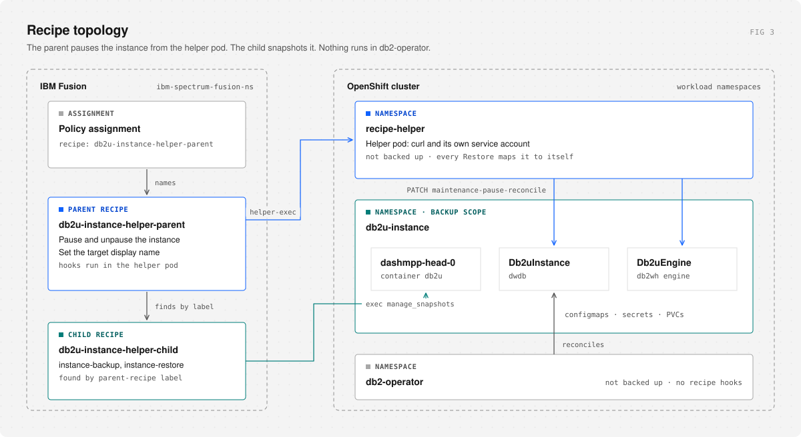
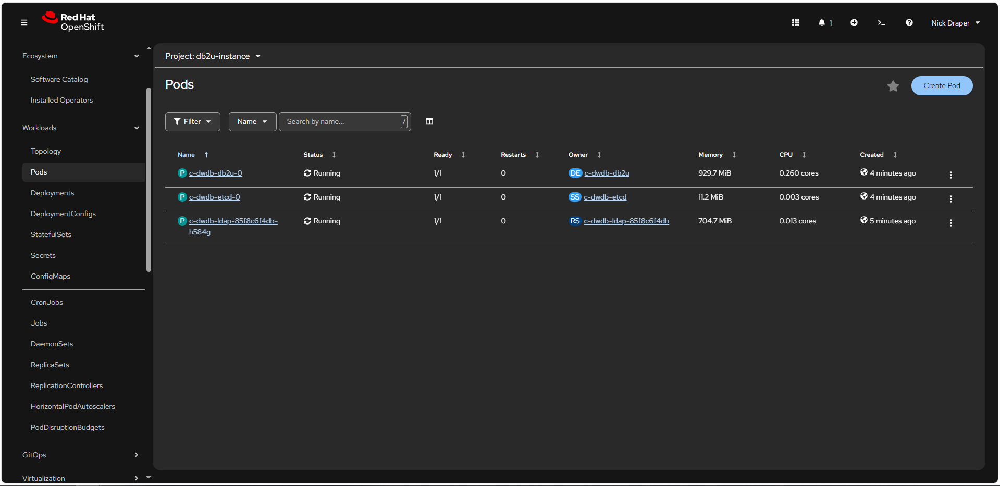
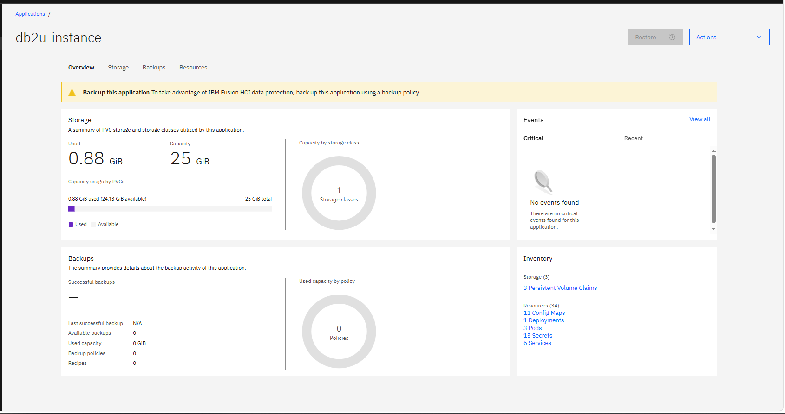
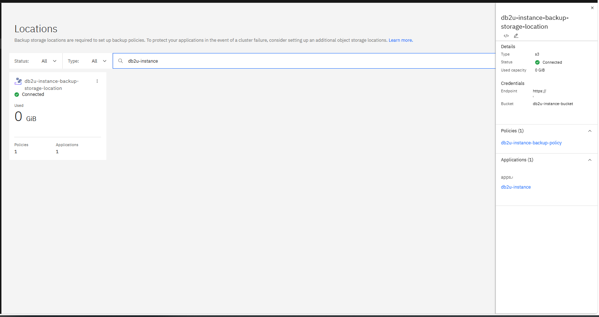
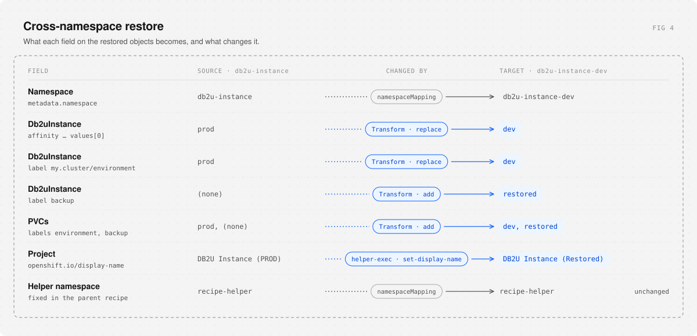
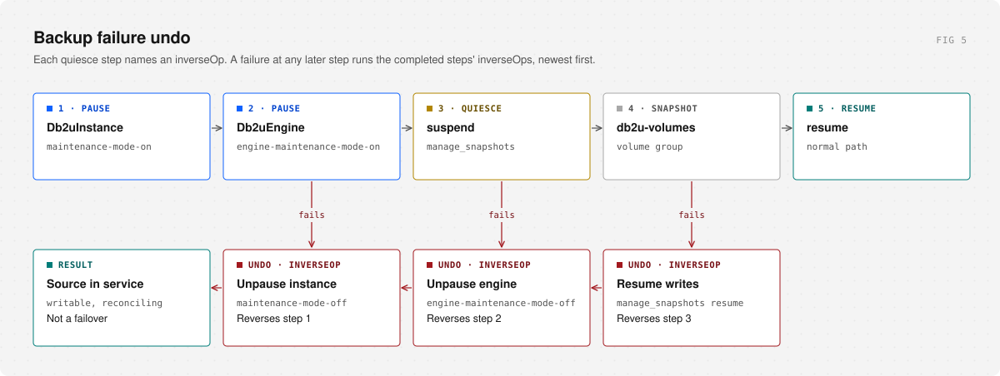

# Deploy step by step

Deploy the recipes on the `db2u-instance` example, then restore it into `db2u-instance-dev`. Every step is a set of commands you run yourself, followed by a check. Don't start the next step until the check passes.

| Namespace | Role |
| --- | --- |
| `db2u-instance` | Source: live `Db2uInstance` `dwdb` (Fusion Application `db2u-instance`) |
| `db2u-instance-dev` | Target: empty project you restore into |
| `db2-operator` | Db2u operator only. Not backed up; no recipe hook runs here |
| `recipe-helper` | Recipe helper pod that pauses and unpauses the instance |
| `ibm-spectrum-fusion-ns` | Storage location, policy, recipes, transform, backups, restores |
| `ibm-backup-restore` | Fusion DataProtectionApplication (Velero plugin) |

```text
PolicyAssignment  db2u-instance-recipe-policy-assignment
  Application     db2u-instance (discovered by Fusion)
  BackupPolicy    db2u-instance-backup-policy → db2u-instance-backup-storage-location
  Recipe          db2u-instance-helper-parent
                    +-- discovers db2u-instance-helper-child (labels)
                    +-- helper-exec hooks run in recipe-helper
```

<picture>
  <source media="(prefers-color-scheme: dark)" srcset="images/architecture-dark.svg">
  
</picture>

---

## 0. Before you start

You need Fusion Backup & Restore 2.10 or newer (tested on 2.12.2), the Db2u operator installed in `db2-operator`, Db2 12.1.4 or newer, S3-compatible object storage, and `oc` logged in as cluster-admin.

Your values go in one file, `.env`. The manifests in the repository are templates with `${NAME}` placeholders, and [`scripts/render.sh`](../scripts/render.sh) fills them from `.env` into `build/`. Every `oc apply` below uses the copy in `build/`. The script only writes files; it never contacts the cluster.

```bash
cp .env.example .env
```

Fill in `.env`: the namespaces, `DB2_LICENSE`, `STORAGE_CLASS`, and the object storage bucket, endpoint, region and key pair from step 1. Each value is described in [`.env.example`](../.env.example). Then render, and load the namespace and storage class names into your shell:

```bash
./scripts/render.sh
source build/env.sh
INSTANCE=dwdb
```

The script stops and names the problem if a value is missing or not a valid name. Run all later commands from the repository root, in the same shell. If you change `.env`, render again: the script rebuilds `build/` from scratch. `.env` and `build/` hold your license and keys; both are git-ignored.

The commands use full resource names, such as `backups.data-protection.isf.ibm.com`, because a Fusion cluster also has Velero's `backups` and `restores`, and may have other `recipes` and `applications`. A short name can return the wrong kind.

**Check**

```bash
oc whoami
oc auth can-i '*' '*' --all-namespaces
oc get pods -n "$OP_NS" -l control-plane=db2u-operator-manager
oc get crd recipes.spp-data-protection.isf.ibm.com transforms.data-protection.isf.ibm.com
```

Expect your user name, `yes`, one `Running` operator manager pod, and both CRDs listed.

---

## 1. Object storage

Create the bucket, policy, user and access key: [object-storage-setup.md](object-storage-setup.md).

You leave this step with an endpoint URL, its CA certificate, a bucket name and an access key pair.

**Check:** you can list the bucket with the new key, for example `mc ls backup/db2u-instance-bucket` after `mc alias set` with the user's key.

---

## 2. Db2 operator, projects and instance

Files: [`db2u-instance/`](../db2u-instance/).

### 2.1 Let the operator watch the source and every restore target

The operator only reconciles namespaces in its OperatorGroup and the `namespace-scope` ConfigMap. A restore target missing from either comes back as an instance nothing reconciles.

**Edit the existing OperatorGroup.** Do not apply a second one; OLM stops installing when a namespace has two. [`config/db2-operator-group.yaml`](../db2u-instance/config/db2-operator-group.yaml) shows the target state only. The name is generated, so look it up and read its current targets:

```bash
OG=$(oc get operatorgroup -n "$OP_NS" -o jsonpath='{.items[0].metadata.name}')
oc get operatorgroup "$OG" -n "$OP_NS" -o jsonpath='{.spec.targetNamespaces}'; echo
```

If the output is empty, the operator watches all namespaces and you can skip the patch. Otherwise add each namespace that is missing, one command per namespace:

```bash
oc patch operatorgroup "$OG" -n "$OP_NS" --type=json \
  -p '[{"op":"add","path":"/spec/targetNamespaces/-","value":"'"$SOURCE_NS"'"}]'
```

```bash
oc patch operatorgroup "$OG" -n "$OP_NS" --type=json \
  -p '[{"op":"add","path":"/spec/targetNamespaces/-","value":"'"$TARGET_NS"'"}]'
```

Then apply the `namespace-scope` ConfigMap. The rendered copy of [`config/namespace-scope-configmap.yaml`](../db2u-instance/config/namespace-scope-configmap.yaml) lists `OP_NS`, `SOURCE_NS` and `TARGET_NS`; if the operator watches other instances too, add them to `data.namespaces` in `build/` first (comma-separated, no spaces):

```bash
oc apply -f build/db2u-instance/config/namespace-scope-configmap.yaml
```

**Check**

```bash
oc get operatorgroup "$OG" -n "$OP_NS" -o jsonpath='{.spec.targetNamespaces}'; echo
oc get configmap namespace-scope -n "$OP_NS" -o jsonpath='{.data.namespaces}'; echo
```

Both lists include your `SOURCE_NS` and `TARGET_NS`. Repeat this step for every new restore target.

### 2.2 Label worker nodes

The instance needs nodes labelled `my.cluster/environment=<env>` that are not `scale.spectrum.ibm.com/role=afm`. The Transform rewrites that value on restore, so label nodes for each environment you restore into:

```bash
oc label node <prod-node> my.cluster/environment=prod
oc label node <dev-node> my.cluster/environment=dev
```

**Check**

```bash
oc get nodes -L my.cluster/environment -L scale.spectrum.ibm.com/role
```

At least one node shows `prod` and one shows `dev`, with no `afm` role.

### 2.3 Projects

```bash
oc apply -f build/db2u-instance/db2u-instance-project.yaml
oc apply -f build/db2u-instance/db2u-instance-dev-project.yaml
```

Create the target project before any restore. Its display name is overwritten with `DB2U Instance (Restored)` when you restore into it.

**Check**

```bash
oc get project "$SOURCE_NS" "$TARGET_NS"
```

### 2.4 Db2uInstance

[`db2u-instance.yaml`](../db2u-instance/db2u-instance.yaml) takes the license from `DB2_LICENSE` and the storage class for all three volumes from `STORAGE_CLASS`. Check the class exists:

```bash
oc get storageclass "$STORAGE_CLASS"
```

Then apply:

```bash
oc apply -f build/db2u-instance/db2u-instance.yaml
```

Wait until the state is `Ready`. A new instance can take 15 minutes or more:

```bash
oc get db2uinstances.db2u.databases.ibm.com "$INSTANCE" -n "$SOURCE_NS" -o jsonpath='{.status.state}'; echo
```

The recipe's readiness check selects instances labelled `for-backup=true`. The example manifest sets it. For an instance created without it, add it now:

```bash
oc label db2uinstances.db2u.databases.ibm.com --all -n "$SOURCE_NS" for-backup=true --overwrite
```

**Check**

```bash
oc get db2uinstances.db2u.databases.ibm.com -n "$SOURCE_NS" -L for-backup
oc get pods -n "$SOURCE_NS" -l name=dashmpp-head-0
```

The instance shows `true` under `FOR-BACKUP`, and `dashmpp-head-0` is `Running`.



Fusion discovers the namespace as Application `db2u-instance`. Confirm it in the Fusion UI under **Applications**:



---

## 3. IBM Fusion Backup & Restore

Files: [`ibm-backup-restore/`](../ibm-backup-restore/).

### 3.1 Velero plugin

Install `db2u-velero-plugin` on the Fusion DataProtectionApplication with IBM's [Fusion backup and restore utility](https://www.ibm.com/docs/en/software-hub/5.4.x?topic=utilities-fusion-backup-restore-utility). Without it, credentials and the license do not come back with a restore. [`config/dpa-db2u-velero-plugin.note.yaml`](../ibm-backup-restore/config/dpa-db2u-velero-plugin.note.yaml) is a note, not a manifest.

**Check**

```bash
oc get dpa velero -n ibm-backup-restore \
  -o jsonpath='{.spec.configuration.velero.customPlugins}'; echo
```

The output names `db2u-velero-plugin`.

### 3.2 Backup storage location

1. **CA certificate.** If the endpoint uses a private CA, create secret `minio-registry-cert-secret` in `ibm-spectrum-fusion-ns` holding it, with the key name your Fusion release documents for `privateCertificateName`:

   ```bash
   oc create secret generic minio-registry-cert-secret -n "$FUSION_NS" \
     --from-file=<key-name>=<path-to-ca.crt>
   ```

   If the endpoint has a publicly trusted certificate, skip this and delete the `privateCertificateName` line from `backup-storage-location.yaml`.

2. **Access key, bucket and endpoint.** These come from `.env`: `S3_ACCESS_KEY_ID` and `S3_ACCESS_KEY` fill [`secret.yaml`](../ibm-backup-restore/backend-storage-location/secret.yaml); `S3_BUCKET_NAME`, `S3_ENDPOINT` and `S3_REGION` fill [`backup-storage-location.yaml`](../ibm-backup-restore/backend-storage-location/backup-storage-location.yaml). `region` is required by the S3 client; MinIO ignores the value.

```bash
oc apply -f build/ibm-backup-restore/backend-storage-location/secret.yaml
oc apply -f build/ibm-backup-restore/backend-storage-location/backup-storage-location.yaml
```

**Check**

```bash
oc get backupstoragelocations.data-protection.isf.ibm.com db2u-instance-backup-storage-location \
  -n "$FUSION_NS" -o jsonpath='{.status.phase}'; echo
```

The phase is `Connected` (some releases report `Available`), and the UI shows the location as **Connected**. An empty phase means it is still checking; wait a minute and run it again.


### 3.3 Backup policy

[`backup-policy.yaml`](../ibm-backup-restore/backend-storage-location/backup-policy.yaml): daily at 04:00 Australia/Sydney, 5 days retention. `provider` must stay `isf-backup-restore`.

```bash
oc apply -f build/ibm-backup-restore/backend-storage-location/backup-policy.yaml
```

**Check**

```bash
oc get backuppolicies.data-protection.isf.ibm.com db2u-instance-backup-policy -n "$FUSION_NS"
```

### 3.4 Recipes and transform

Files: [`ibm-backup-restore/recipe/`](../ibm-backup-restore/recipe/), [`ibm-backup-restore/transform/`](../ibm-backup-restore/transform/).

Before applying the [Transform](../ibm-backup-restore/transform/transform.yaml), check that its JSON paths and `resourceNameRegex` (the instance name) match your `Db2uInstance`. It rewrites the affinity value and `my.cluster/environment` label to `${ENV}` from the Restore's `transformMapping`, sets the same label on every restored PVC, and adds `backup=restored` to both.

```bash
oc apply -f build/ibm-backup-restore/recipe/parent-recipe.yaml
oc apply -f build/ibm-backup-restore/recipe/child-recipe.yaml
oc apply -f build/ibm-backup-restore/transform/transform.yaml
```

**Check**

```bash
oc get recipes.spp-data-protection.isf.ibm.com -n "$FUSION_NS" \
  db2u-instance-helper-parent db2u-instance-helper-child
oc get recipes.spp-data-protection.isf.ibm.com db2u-instance-helper-child -n "$FUSION_NS" \
  -o jsonpath='{.metadata.labels.dp\.isf\.ibm\.com/parent-recipe}'; echo
oc get transforms.data-protection.isf.ibm.com db2u-instance-restore-transform -n "$FUSION_NS"
```

Both recipes and the transform are listed, and the child's label prints `db2u-instance-helper-parent`. That label is how the parent finds the child; nothing names it directly.

### 3.5 Policy assignment

[`policy-assignment.yaml`](../ibm-backup-restore/policy-assignment/policy-assignment.yaml) ties Application `db2u-instance`, the policy and the parent recipe together. Apply it **before the first backup**: a backup taken without the recipe has no quiesce, and a restore cannot add one later. `runNow: false` keeps it from starting a backup.

```bash
oc apply -f build/ibm-backup-restore/policy-assignment/policy-assignment.yaml
```

**Check**

```bash
oc get policyassignments.data-protection.isf.ibm.com db2u-instance-recipe-policy-assignment -n "$FUSION_NS" \
  -o jsonpath='{.spec.recipe.name}{" runNow="}{.spec.runNow}'; echo
```

Expect `db2u-instance-helper-parent runNow=false`.



---

## 4. Recipe helper

Files: [`recipe-helper/`](../recipe-helper/). Do this on every cluster that backs up **and** every cluster that restores.

The parent recipe's `helper-exec` hooks run `curl` in this pod with its service account token. They patch `maintenance-pause-reconcile` on every `Db2uInstance` and `Db2uEngine` in the instance namespace, and the target Project display name on restore. The ClusterRole grants exactly that; without it the hooks fail with `Forbidden`.

Mirror a UBI 9 minimal image (it ships `curl`) into a registry the cluster can pull from, and set `image` in [`deployment.yaml`](../recipe-helper/deployment.yaml):

```bash
grep -n 'image:' recipe-helper/deployment.yaml
```

Apply the five manifests in this order:

```bash
oc apply -f build/recipe-helper/project.yaml
oc apply -f build/recipe-helper/service-account.yaml
oc apply -f build/recipe-helper/cluster-role.yaml
oc apply -f build/recipe-helper/cluster-role-binding.yaml
oc apply -f build/recipe-helper/deployment.yaml
oc rollout status deployment/recipe-helper -n "$HELPER_NS" --timeout=180s
```

**Check**

```bash
oc get pods -n "$HELPER_NS" -l app=recipe-helper
SA=system:serviceaccount:$HELPER_NS:recipe-helper
oc auth can-i list  db2uinstances.db2u.databases.ibm.com --all-namespaces --as="$SA"
oc auth can-i patch db2uinstances.db2u.databases.ibm.com --all-namespaces --as="$SA"
oc auth can-i list  db2uengines.db2u.databases.ibm.com   --all-namespaces --as="$SA"
oc auth can-i patch db2uengines.db2u.databases.ibm.com   --all-namespaces --as="$SA"
oc auth can-i patch namespaces --as="$SA"
```

The pod is `Running` and every `can-i` prints `yes`.

The helper namespace is fixed in the recipe, so every Restore must map it to itself (`recipe-helper: recipe-helper`). See [README: Why a helper pod](../README.md#why-a-helper-pod).

---

## Ready to back up?

Run these once more before the first backup. Each line should give the result on the right.

| Check | Command | Expect |
| --- | --- | --- |
| Operator running | `oc get pods -n "$OP_NS" -l control-plane=db2u-operator-manager` | `Running` |
| Operator watches source and target | `oc get operatorgroup "$OG" -n "$OP_NS" -o jsonpath='{.spec.targetNamespaces}'` | both namespaces, or empty for all |
| Instance ready | `oc get db2uinstances.db2u.databases.ibm.com "$INSTANCE" -n "$SOURCE_NS" -o jsonpath='{.status.state}'` | `Ready` |
| Instance labelled | `oc get db2uinstances.db2u.databases.ibm.com -n "$SOURCE_NS" -L for-backup` | `true` |
| Storage connected | `oc get backupstoragelocations.data-protection.isf.ibm.com -n "$FUSION_NS"` | `Connected` in the UI |
| Assignment names the parent | step 3.5 check | `db2u-instance-helper-parent runNow=false` |
| Helper running and allowed | step 4 check | `Running`, every `can-i` is `yes` |

Then back up and restore with [operations.md](operations.md).

---

## 5. Operations

Backups, restores, the checks after each, and the UI walkthrough: [operations.md](operations.md).

<picture>
  <source media="(prefers-color-scheme: dark)" srcset="images/transform-dark.svg">
  
</picture>

---

## Failures

<picture>
  <source media="(prefers-color-scheme: dark)" srcset="images/failover-dark.svg">
  
</picture>

| Symptom | Check |
| --- | --- |
| `KeyError: 'recipe-helper'` on restore | The Restore's `namespaceMapping` lacks `recipe-helper: recipe-helper` |
| `KeyError: 'db2-operator'` on restore | An old recipe still has a hook in `db2-operator`. Apply the current recipes (§3.4) |
| Helper hook `Forbidden` | Run the §4 check on that cluster; check the ClusterRoleBinding subject namespace |
| Helper hook finds no pod | Helper deployment not `Running`, or label `app=recipe-helper` changed |
| Restored instance never reconciles | Target missing from the OperatorGroup or `namespace-scope` ConfigMap (§2.1) |
| Restored pods `Pending` | No node labelled `my.cluster/environment=<ENV>` (§2.2) |
| Readiness check never matches | `for-backup=true` on the instance (§2.4); engine labels in `db2uengine-check` |
| Variables / op command | Only `${GROUP.*}` in commands; shell variables use `$name`; no dollar-brace text in recipe comments |
| `manage_snapshots` op does not run | Use the JSON-array command form `["/bin/bash", "-c", "..."]` |
| Ready but trial license | Velero plugin (§3.1), Db2 12.1.4 or newer |

---

## File map

Paths are relative to the repository root. The YAML files are templates; apply their rendered copies from `build/`.

| Path | Role |
| --- | --- |
| `db2u-instance/` | Templates: OperatorGroup and namespace-scope targets, projects, `Db2uInstance` |
| `ibm-backup-restore/backend-storage-location/` | Credentials secret, storage location, backup policy |
| `ibm-backup-restore/recipe/parent-recipe.yaml` | Parent recipe: maintenance mode, restore ordering, display name |
| `ibm-backup-restore/recipe/child-recipe.yaml` | Child recipe: the `Db2uInstance`, its volumes and snapshot hooks |
| `ibm-backup-restore/transform/transform.yaml` | Transform for a cross-namespace restore |
| `ibm-backup-restore/policy-assignment/policy-assignment.yaml` | PolicyAssignment naming the parent recipe |
| `ibm-backup-restore/config/` | Velero plugin note (not applied) |
| `ibm-backup-restore/operations/backup.yaml` | Backup CR |
| `ibm-backup-restore/operations/restore.yaml` | Restore CR: `db2u-instance` → `db2u-instance-dev` |
| `recipe-helper/` | Helper project, service account, RBAC, deployment |
| `.env.example` | The values to copy into `.env`: namespaces, license, storage class, object storage |
| `scripts/render.sh` | Fills the templates from `.env` into `build/`, and writes `build/env.sh`. Never contacts the cluster |
| `build/` | Rendered manifests and `env.sh`; what you apply. Git-ignored |
| `.githooks/pre-commit` | Runs `scripts/check-placeholders.sh` on commit (`git config core.hooksPath .githooks`) |
| `scripts/check-placeholders.sh` | Refuses a commit that stages `.env` or `build/`, or fills a template's license or key in place |
| `scripts/discover-instance-resources.sh` | Read-only inventory of a namespace before you widen the allow-list |
| `docs/images/` | Figures; see [`docs/images/STYLE.md`](images/STYLE.md) to change them |
