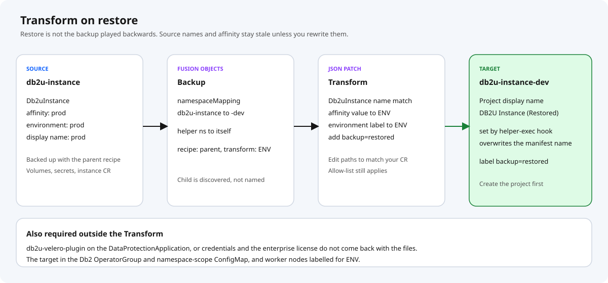

# Db2u Fusion Backup & Restore — end to end

This guide is the deploy and test procedure for the recipes in this repository.

It assumes a production layout:

- the Db2u operator runs in `db2-operator`
- each database is a `Db2uInstance` in its own namespace
- you back up the instance, not the operator
- restore into a **different** namespace is a normal operation

There is one README. This file is the procedure. Diagrams live in [`images/`](images/).

Placeholders used below. Replace them with your names.

| Placeholder | Example | Meaning |
|-------------|---------|---------|
| `db2u-prod` | source project | Namespace that holds the live `Db2uInstance` |
| `db2u-qa` | target project | Empty namespace you restore into |
| `db2-operator` | operator project | Where `db2u-operator-manager` runs |
| `my-db2` | instance name | `metadata.name` of the `Db2uInstance` |
| `ibm-spectrum-fusion-ns` | Fusion namespace | Where recipes, policies, and backups live |

---

## 1. What you are deploying

```
PolicyAssignment
  Application          instance namespace only (db2u-prod)
  BackupPolicy         schedule + retention + storage location
  Recipe               db2u-parent-recipe
        |
        +-- discovers db2u-instance-child-recipe
```

**Backup** (parent, then child):

1. Pause `Db2uInstance` reconcile (`maintenance-pause-reconcile=true`).
2. Pause `Db2uEngine` reconcile.
3. Child: back up configmaps and secrets, back up the `Db2uInstance`, `manage_snapshots suspend`, snapshot volumes, `manage_snapshots resume`.
4. Clear both maintenance annotations.

If the volume snapshot fails after suspend or maintenance-on, `inverseOp` runs the matching resume / maintenance-off so the database is not left locked.

**Restore into a new namespace** (parent, then child):

1. Patch the **target** Project `openshift.io/display-name` from the namespace suffix (`db2u-qa` → `Db2 Warehouse (QA)`).
2. Child: restore volumes, configmaps/secrets, and the `Db2uInstance` (Transform JSON patches apply here), wait until the engine is Ready, `manage_snapshots restore`, `resume`, wait until the instance is Ready **and** `FormationStatus` is `OK`, annotate `db2u.fusion/restored=true`.
3. Sleep 300 seconds so controllers settle.
4. Clear maintenance annotations if they were restored with the CR.


The child is not named on the `PolicyAssignment` or `Restore`. Fusion finds it by:

```yaml
dp.isf.ibm.com/parent-recipe: db2u-parent-recipe
dp.isf.ibm.com/parent-recipe-namespace: ibm-spectrum-fusion-ns
```

---

## 2. Prerequisites

Confirm these before you apply anything.

**Cluster**

- IBM Fusion Backup & Restore **2.10 or newer** (parent/child recipes, annotation hooks).
- OpenShift `oc` logged in with permission to create Projects and to edit Fusion CRs in `ibm-spectrum-fusion-ns`.
- `jq` on the workstation (`scripts/restore-pre-req.sh`).

**Database**

- Db2u operator installed in `db2-operator` (change the parent `groups.db2-operator.includedNamespaces` if yours differs; the hook uses `${GROUP.db2-operator.namespace}`).
- A Ready `Db2uInstance` in `db2u-prod`, labeled later with `for-backup=true`.
- Db2 **12.1.4+**.

**Velero plugin**

Credentials and license configuration are preserved only when the Db2u Velero plugin is on the Fusion `DataProtectionApplication`. Install it with the IBM Software Hub Fusion backup and restore utility:

https://www.ibm.com/docs/en/software-hub/5.4.x?topic=utilities-fusion-backup-restore-utility

```bash
oc get dpa velero -n ibm-backup-restore \
  -o jsonpath='{.spec.configuration.velero.customPlugins}' ; echo
```

You should see `db2u-velero-plugin` (image such as `icr.io/db2u/db2u-velero-plugin:<version>` from the current IBM docs). See [`examples/dpa-db2u-velero-plugin.example.yaml`](../examples/dpa-db2u-velero-plugin.example.yaml). Do not apply that file; it is a reminder, not a full DPA.

**Object storage**

Examples under [`examples/`](../examples/) create the secret, storage location, and policy. The secret and the Db2 license ship as `REPLACE_WITH_` placeholders. Put your own values in before `scripts/configure-bnr.sh` will apply them.

**Assign the recipe before the first backup.** A backup taken with no recipe has no quiesce and no resource order. You cannot add that later.

---

## 3. One-time cluster setup


```bash
./scripts/restore-pre-req.sh
```

This adds `get`, `list`, and `patch` on `db2uengines` and `db2uinstances` to ClusterRole `transaction-manager-ibm-backup-restore`. `patch` is required for the annotation that marks an instance restored. Run it on every cluster that will **restore** (spoke and hub, if they differ).

Confirm the operator pod label the parent hook selects:

```bash
oc get pods -n db2-operator -l control-plane=db2u-operator-manager
```

One Running pod in container `manager` is required. If the label or operator namespace differs, edit the parent recipe’s `db2-operator` group / hook `labelSelector` before apply.

---

## 4. Install the recipes

`scripts/configure-bnr.sh` in the next section applies these two files. Run the commands here when you already have the projects, secret, location, and policy, and you only need the recipes.

```bash
oc apply -f recipe/db2u-parent-recipe.yaml
oc apply -f recipe/db2u-instance-child-recipe.yaml

oc get recipe -n ibm-spectrum-fusion-ns \
  -l dp.isf.ibm.com/parent-recipe=db2u-parent-recipe
```

Expected: `db2u-instance-child-recipe` is listed.

---

## 5. Configure Backup & Restore

Replace every `REPLACE_WITH_` value first.

| File | You replace |
|------|-------------|
| `examples/backup-secret.example.yaml` | `REPLACE_WITH_ACCESS_KEY_ID`, `REPLACE_WITH_SECRET_ACCESS_KEY` |
| `examples/backup-storage-location.example.yaml` | `REPLACE_WITH_S3_ENDPOINT`, `REPLACE_WITH_BUCKET_NAME` |
| `examples/db2uinstance.example.yaml` | `REPLACE_WITH_DB2_LICENSE`, `REPLACE_WITH_STORAGE_CLASS` |

The license value is the enterprise license text from IBM, not a trial key. Do not commit the filled-in files.

`scripts/configure-bnr.sh` applies the objects in this order. It exits if a placeholder is still present.

1. Projects `db2u-prod` and `db2u-qa`
2. `Db2uInstance` `my-db2` in `db2u-prod`
3. Secret `db2u-backup-secret`
4. `BackupStorageLocation` `db2u-prod-backup-storage-location`
5. `BackupPolicy` `db2u-prod-backup-policy` (04:00 Australia/Sydney, keep 5 days)
6. Parent and child recipes
7. `Application` `db2u-prod` (instance namespace only, not `db2-operator`)
8. `PolicyAssignment` `db2u-prod-policy-assignment` with `runNow: false` and recipe `db2u-parent-recipe`
9. Example Transform
10. `restore-pre-req.sh` and `backup-pre-req.sh db2u-prod`

```bash
./scripts/configure-bnr.sh
```

The same steps by hand:

```bash
oc apply -f examples/namespace-db2u-prod.yaml
oc apply -f examples/namespace-db2u-qa.yaml
oc apply -f examples/db2uinstance.example.yaml
oc apply -f examples/backup-secret.example.yaml
oc apply -f examples/backup-storage-location.example.yaml
oc apply -f examples/backup-policy.example.yaml
oc apply -f recipe/db2u-parent-recipe.yaml
oc apply -f recipe/db2u-instance-child-recipe.yaml
oc apply -f examples/application.example.yaml
oc apply -f examples/policy-assignment.example.yaml
oc apply -f examples/db2u-transform-prod-to-qa.example.yaml
./scripts/restore-pre-req.sh
./scripts/backup-pre-req.sh db2u-prod
```

If the instance already exists, skip `db2uinstance.example.yaml` and label it with `backup-pre-req.sh` instead of applying a second CR.

---

## 6. Label the instance

Readiness checks select `for-backup=true`. Without it, restore waits until timeout.

```bash
./scripts/backup-pre-req.sh db2u-prod
oc get db2uinstance -n db2u-prod --show-labels
```

Run this again whenever a new `Db2uInstance` appears in that namespace.

Optional, before you change what the recipe includes:

```bash
./scripts/discover-instance-resources.sh db2u-prod
```

Requires the [`oc get-resources`](https://github.com/Sandeep-Prajapati/kubectl-get-resources) plugin. Compare kinds to the child allow-list: volumes, configmaps, secrets, `db2uinstances.db2u.databases.ibm.com`. Add a type only if a test restore proves the instance needs it. The allow-list is intentional: IBM’s sample excludes a denylist and then copies everything else.

---

## 7. Prove the configuration

```bash
./scripts/test-bnr.sh preflight
```

That command fails unless all of the following are true:

- `db2u-prod` and `db2u-qa` exist, and the operator manager pod is Running
- Secret, storage location, policy, application, assignment, and both recipes exist
- The live secret and `spec.license.value` do not still say `REPLACE_WITH_`
- The application includes `db2u-prod` and does not include `db2-operator`
- The assignment names `db2u-parent-recipe` and `runNow` is false
- The child recipe label points at the parent
- `my-db2` is `for-backup=true`, state `Ready`, and `dashmpp-head-0` is Running
- The storage location phase is set and is not a failure

Do not start a backup until preflight passes.

## 8. Test a backup

Confirm the instance is Ready:

```bash
oc get db2uinstance -n db2u-prod
oc get pods -n db2u-prod -l name=dashmpp-head-0
```

`dashmpp-head-0` must be Running. `manage_snapshots` runs in container `db2u` on that pod.

Start a backup from the Fusion UI (**Back up now**) or your usual `Backup` / policy action. Do not start one until the PolicyAssignment references `db2u-parent-recipe`.

Watch progress:

```bash
oc get backup -n ibm-spectrum-fusion-ns
oc describe backup -n ibm-spectrum-fusion-ns <BACKUP_NAME>
```

**Pass criteria**

- Backup phase is successful / completed (wording depends on Fusion version).
- Recipe log shows, in order: maintenance-mode-on, engine-maintenance-mode-on, resource backup, suspend, volume group, resume, maintenance-mode-off, engine-maintenance-mode-off.
- After the job, the instance is writable again:

```bash
oc get db2uinstance -n db2u-prod -o jsonpath='{.items[0].metadata.annotations.db2u\.databases\.ibm\.com/maintenance-pause-reconcile}{"\n"}'
```

Empty or absent means maintenance was cleared. If the backup failed midway, `inverseOp` should still have cleared it; if the annotation is stuck at `true`, run the maintenance-off logic or remove the annotation and check Fusion hook logs before another attempt.

Record the Backup object name. Restore needs that exact string:

```bash
./scripts/test-bnr.sh backup
oc get backup -n ibm-spectrum-fusion-ns
```

`test-bnr.sh backup` passes only when the newest Backup phase is `Completed`, `Succeeded`, `Success`, or `Available`, and `maintenance-pause-reconcile` is gone from `my-db2`.

---

## 9. Prepare the target namespace

Create the target project **before** restore. The first restore hook patches `openshift.io/display-name` on that namespace.

```bash
oc new-project db2u-qa
```

The project can be empty. Do not pre-create a `Db2uInstance`; the restore creates it.

Nodes that should run the restored database need the affinity value your Transform writes (the example sets the first nodeSelector value to `qa`). If your instance CR has no such affinity path, edit the Transform in the next step or the restored pods will not schedule.

---

## 10. Edit the Transform and Restore

Copy the examples and edit them. Do not apply the placeholders as-is.



**Transform** — [`examples/db2u-transform-prod-to-qa.example.yaml`](../examples/db2u-transform-prod-to-qa.example.yaml)

- Set `resourceNameRegex` to the source instance name (`my-db2`), or the regex will not match and affinity/labels stay as backed up.
- Point JSON paths at fields that exist on **your** `Db2uInstance`. The example path updates node affinity environment and `app.kubernetes.io/environment`. `/` in a label key is `~1` in a JSON Pointer.
- PVC label updates are best-effort. Remove a patch whose path is absent, or that resource fails the transform.

**Restore** — [`examples/db2u-restore-cross-namespace.example.yaml`](../examples/db2u-restore-cross-namespace.example.yaml)

- `metadata.name`: unique, for example `db2u-restore-prod-to-qa-test1`
- `spec.backup`: the exact Backup name from step 7
- `namespaceMapping`: `db2u-prod: db2u-qa`
- `spec.recipe.name`: `db2u-parent-recipe` (the parent, not the child)
- `spec.transform`: the Transform name you applied

```bash
oc apply -f examples/db2u-transform-prod-to-qa.example.yaml
oc apply -f examples/db2u-restore-cross-namespace.example.yaml
```

Applying the Restore starts the job.

---

## 11. Watch the restore

```bash
oc get restore -n ibm-spectrum-fusion-ns
oc describe restore -n ibm-spectrum-fusion-ns db2u-restore-prod-to-qa-test1
oc get db2uinstance,pods,pvc -n db2u-qa -w
```

Expected order:

1. Target project display name becomes `Db2 Warehouse (QA)` because the suffix after the last `-` is `qa`.
2. PVCs appear in `db2u-qa`.
3. Configmaps, secrets, and the `Db2uInstance` appear.
4. Engine reaches Ready, then `manage_snapshots restore` and `resume` run on `dashmpp-head-0`.
5. Instance check passes (`Ready` and `FormationStatus` `OK`).
6. Annotation `db2u.fusion/restored=true` is set.
7. Parent sleeps 300 seconds, then clears maintenance annotations.

The instance check is strict on purpose. If your `Db2uInstance` status has `state: Ready` but no `FormationStatus` condition, the check never succeeds. Edit the condition in `recipe/db2u-instance-child-recipe.yaml` back to:

```yaml
condition: '{$.status.state} == {"Ready"}'
```

re-apply the child recipe, and run a new Restore. Do not reuse a failed Restore object; create one with a new name.

**Pass criteria**

```bash
oc get ns db2u-qa -o jsonpath='{.metadata.annotations.openshift\.io/display-name}{"\n"}'
# Db2 Warehouse (QA)

oc get db2uinstance -n db2u-qa \
  -o jsonpath='{.items[0].metadata.annotations.db2u\.fusion/restored}{"\n"}'
# true

oc get db2uinstance -n db2u-qa
# Ready

oc get pods -n db2u-qa
# dashmpp-head-0 Running, no CrashLoop from license/auth
```

Then validate the database itself (connect with your normal client, check a known table, confirm the license is the enterprise license and not a trial default). That last check is what the Velero plugin is for. A Ready pod with a trial license is a failed restore.

Source `db2u-prod` should be unchanged and still Ready.

```bash
./scripts/test-bnr.sh restore
```

`test-bnr.sh restore` checks the QA display name, `db2u.fusion/restored=true`, and Ready on both the target and the source. It does not log in to Db2. Check the enterprise license yourself before you treat the restore as finished.

---

## 12. Display name rules

`set-display-name` does not use a hardcoded environment list. It uppercases the segment after the final `-`:

| Target namespace | Project display name |
|------------------|----------------------|
| `db2u-qa` | `Db2 Warehouse (QA)` |
| `db2u-dev` | `Db2 Warehouse (DEV)` |
| `dw-stg` | `Db2 Warehouse (STG)` |

Change the `Db2 Warehouse` prefix in the parent recipe if the product name differs. Re-apply the parent recipe before the next restore.

---

## 13. When something fails


If a backup fails after suspend, `inverseOp` should resume I/O and clear maintenance. Confirm the annotation is gone before you run another backup. A Restore into another namespace is a separate action. It is not what `inverseOp` does.

| Symptom | What to check |
|---------|----------------|
| Hook cannot find operator manager | Pod label `control-plane=db2u-operator-manager` in the operator namespace. Parent `groups.db2-operator.includedNamespaces` and `${GROUP.db2-operator.namespace}`. |
| Backup stays in hook failure immediately | PolicyAssignment recipe is the parent. Instance namespace is on the Application. `for-backup=true` is only required for the **restore** readiness check, but label it before backup so the same objects are identifiable. |
| `manage_snapshots` fails | Pod `name=dashmpp-head-0`, container `db2u`. Quiesce must run there; a Job hook cannot see that binary. |
| Database left read-only after a failed backup | `inverseOp` should have resumed. If not, check the annotation `db2u.databases.ibm.com/maintenance-pause-reconcile` and Fusion hook logs. |
| Restore permission error on Db2u APIs | Re-run `./scripts/restore-pre-req.sh` on the target cluster. |
| `failed calling webhook` | An admission webhook fired before its service was up. This pack does not back up operator webhooks. Set that webhook `failurePolicy` to `Ignore`, retry the restore without deleting restored PVCs, then set `failurePolicy` back. |
| Restore times out for a long time | Raise Restore timeout and the check timeouts. Size the target pods for crash recovery. Do not assume a timed-out restore is harmless; watch the target namespace until the job is finished or cancelled. |
| Display name still shows the source | Target project did not exist when `set-display-name` ran, or `${GROUP.db2u-volumes.namespace}` did not resolve to the mapped namespace. |
| Instance Ready but login/license fails | Db2u Velero plugin missing on the DPA, or source was older than 12.1.4. |
| FormationStatus check never passes | Your CR does not publish that condition. Simplify the check as in step 10. |

Fusion hook logs are on the backup/restore job pods in the Fusion namespaces (`ibm-backup-restore` / `ibm-spectrum-fusion-ns`, depending on version). `oc describe` on the Backup or Restore usually names the failing hook (`maintenance-mode-on`, `suspend`, `stateReady`, `set-restored`).

---

## 14. What this test does not cover

- Backing up `db2-operator`, OLM subscriptions, or `Db2uCluster`.
- Multiple instances in one Application (parallel child workflows). That needs a hooks-only sequence; a volume group forces sequential execution.
- Replacing `backup-pre-req.sh` with a label hook. The script stays outside the recipe so the label exists before backup selection.
- Disaster recovery of the whole cluster. Fusion restores the application after the cluster and the operator exist.

---

## 15. File map

| Path | Role in this procedure |
|------|------------------------|
| `recipe/db2u-parent-recipe.yaml` | Operator hooks, display name, backup/restore order |
| `recipe/db2u-instance-child-recipe.yaml` | Volumes, secrets, instance CR, quiesce, readiness, restored annotation |
| `scripts/backup-pre-req.sh` | `for-backup=true` |
| `scripts/restore-pre-req.sh` | ClusterRole for Db2u get/list/patch |
| `scripts/discover-instance-resources.sh` | Inventory before changing the allow-list |
| `examples/namespace-db2u-prod.yaml` | Source project |
| `examples/namespace-db2u-qa.yaml` | Target project |
| `examples/db2uinstance.example.yaml` | Instance CR. Replace license and storage class |
| `examples/backup-secret.example.yaml` | S3 keys. Replace both placeholders |
| `examples/backup-storage-location.example.yaml` | Bucket and endpoint placeholders |
| `examples/backup-policy.example.yaml` | Schedule and retention |
| `examples/application.example.yaml` | Instance namespace only |
| `examples/policy-assignment.example.yaml` | Application, policy, and parent recipe |
| `examples/db2u-transform-prod-to-qa.example.yaml` | Edit, then apply |
| `examples/db2u-restore-cross-namespace.example.yaml` | Edit the backup name, then apply |
| `examples/dpa-db2u-velero-plugin.example.yaml` | Plugin reminder only |
| `scripts/configure-bnr.sh` | Apply the objects above after placeholders are replaced |
| `scripts/test-bnr.sh` | `preflight`, `backup`, and `restore` checks |
| `docs/images/architecture.svg` | Parent, child, and the two namespaces |
| `docs/images/transform.svg` | Cross-namespace restore |
| `docs/images/failover.svg` | `inverseOp` if the snapshot fails |
| `docs/images/deploy.svg` | Order of operations |
